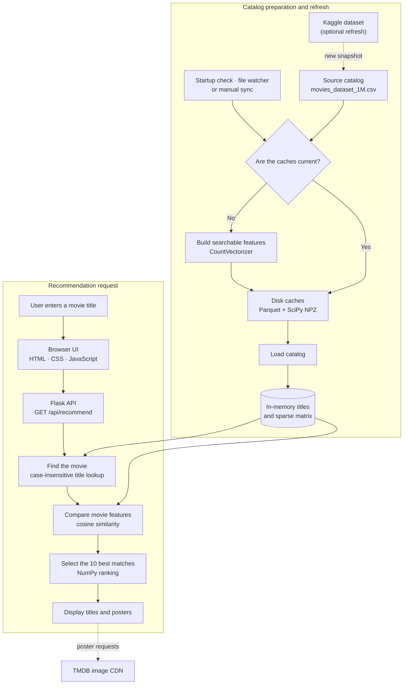

# Movie Recommendation Engine (V2 — Scaling)

A content-based recommendation system that searches **1,462,150 TMDB titles** without precomputing an impractically large movie-to-movie similarity matrix.

The system combines a 10,000-feature sparse text index, request-time cosine similarity, compact binary caches, and live catalog refreshes in a Flask application that can run on ordinary hardware.

## At a Glance

| Area | Implementation |
| --- | --- |
| Catalog | 1,462,150 movies in the current dataset snapshot |
| Recommendation method | Content-based filtering over keywords, genres, and overview text |
| Feature representation | `CountVectorizer` with up to 10,000 features |
| Similarity calculation | Cosine similarity against a SciPy sparse matrix at request time |
| Cached storage | Apache Parquet for movie metadata and SciPy NPZ for feature vectors |
| Backend | Flask REST API with an in-memory catalog |
| Frontend | Vanilla JavaScript and CSS served by Flask |
| Dataset refresh | Kaggle sync, manual API trigger, and a local file watcher |

## Why This Architecture?

A common tutorial recommender precomputes the similarity between every pair of movies. That approach works for a few thousand records, but its memory requirement grows quadratically.

For 1,462,150 movies, a dense `float32` similarity matrix would require:

```text
1,462,150 × 1,462,150 × 4 bytes = 8.55 TB (about 7.78 TiB)
```

This project avoids that matrix. It stores one sparse feature vector per movie and compares only the selected movie with the catalog when a request arrives.

| Conventional approach | This project | Result |
| --- | --- | --- |
| Precompute every movie pair | Compute one query-to-catalog comparison | Avoids the O(N²) similarity matrix |
| Parse and vectorize the CSV at every start | Reuse Parquet and NPZ caches | Faster warm starts |
| Hold old and new catalogs together during refresh | Build on disk, release the active catalog, then reload | Reduces reload-time memory pressure |
| Fail a search during a catalog swap | Return `503` and retry from the browser | The UI can recover automatically |

## Architecture

The upper path is what a visitor experiences. The lower path shows how the searchable catalog is prepared and refreshed.



## How It Works

### 1. Build the searchable catalog

`dataset_sync.py` reads only the five source columns needed by the recommender: `title`, `keywords`, `genres`, `overview`, and `poster_path`.

The text fields are cleaned and combined before `CountVectorizer` creates a sparse word-count matrix with at most 10,000 features. The generated artifacts are:

- `movies_cache.parquet` — normalized titles and poster paths.
- `count_matrix.npz` — the sparse feature matrix used for similarity calculations.

In the current local snapshot, these files are approximately **86 MB** and **52 MB**, compared with a **646 MB** source CSV.

### 2. Start the application

On startup, `init_recommender()` checks whether both cache files exist and are at least as new as the CSV.

- When the caches are current, the application loads them directly.
- When either cache is missing or stale, the application rebuilds both artifacts and then loads them.
- After the initial load, the application starts a background Kaggle check and a daemon that watches the local CSV every 10 seconds.

The active DataFrame and sparse matrix are kept in memory so a recommendation request does not need to read the full dataset from disk.

### 3. Generate recommendations

For `GET /api/recommend?movie=Interstellar`, the server:

1. Normalizes the supplied title and looks for an exact match.
2. Falls back to a case-insensitive substring match when necessary.
3. Selects the matched movie's sparse feature vector.
4. Runs `cosine_similarity()` between that vector and the complete sparse matrix.
5. Sorts the scores with NumPy and returns the ten highest-scoring movies, excluding the selected movie.
6. Sends titles and TMDB poster paths to the browser as JSON.

This is an **O(N)** comparison for each request. It trades some request-time CPU work for the enormous memory saving gained by avoiding an O(N²) similarity table.

### 4. Refresh the catalog

The catalog can change in three ways:

- A non-blocking startup task checks Kaggle for a newer snapshot.
- The file watcher detects changes to `movies_dataset_1M.csv`.
- `POST /api/dataset/sync` starts a manual Kaggle check.

When an update is found, the new disk caches are built first. `drain_and_swap()` then clears the active in-memory references, runs garbage collection, and loads the refreshed Parquet and NPZ files under a lock.

If the API observes the reload state, it returns HTTP `503`. The frontend waits 1.5 seconds and retries up to three times.

## API Reference

| Method | Endpoint | Purpose |
| --- | --- | --- |
| `GET` | `/` | Serve the web interface |
| `GET` | `/api/recommend?movie=<title>` | Return ten content-based recommendations |
| `GET` | `/api/dataset/status` | Report catalog size, reload state, reload time, and source |
| `POST` | `/api/dataset/sync` | Start a background Kaggle synchronization check |

Example response:

```json
{
  "movie": "Interstellar",
  "recommendations": [
    {
      "title": "Example recommendation",
      "poster_path": "/example-poster.jpg"
    }
  ]
}
```

## Run Locally

### Prerequisites

- Python 3.9 or newer
- Enough free disk space for the source CSV and generated caches
- A Kaggle API token if the dataset requires authenticated access

### 1. Clone and enter the repository

```powershell
git clone https://github.com/Krt1n/Movie_Recommendation_Engine.git
cd Movie_Recommendation_Engine
```

### 2. Create a virtual environment

```powershell
python -m venv .venv
.\.venv\Scripts\Activate.ps1
```

On macOS or Linux, activate it with:

```bash
source .venv/bin/activate
```

### 3. Install dependencies

```powershell
pip install -r requirements.txt
```

### 4. Download the dataset

The large CSV and generated caches are intentionally excluded from Git. Download the current Kaggle dataset before the first start:

```powershell
python download_dataset.py
```

Kaggle can read credentials from its standard configuration. This project also supports the environment used by `kagglehub`, including `KAGGLE_API_TOKEN` where available.

### 5. Start the application

```powershell
python app.py
```

The first start builds the Parquet and NPZ caches. Later starts reuse them while they remain current. Open [http://localhost:5000](http://localhost:5000) after the server reports that the recommender is ready.

## Project Structure

```text
Movie_Recommendation_Engine/
├── app.py                     # Flask routes, recommendation logic, and reload lifecycle
├── dataset_sync.py            # Kaggle sync, cache validation, cache build, and cache load
├── download_dataset.py        # One-time Kaggle dataset download helper
├── requirements.txt           # Python dependencies
├── static/
│   ├── index.html             # Search interface
│   ├── script.js              # API calls, result cards, and 503 retry logic
│   └── style.css              # Responsive dark interface
├── recommender.ipynb          # Recommendation experiments
├── consine_similarity.ipynb   # Similarity experiments
├── movies_dataset_1M.csv      # Source dataset; generated/downloaded and ignored by Git
├── movies_cache.parquet       # Metadata cache; generated and ignored by Git
└── count_matrix.npz           # Sparse feature cache; generated and ignored by Git
```

## Technology Stack

| Layer | Technology |
| --- | --- |
| Web interface | HTML, CSS, vanilla JavaScript |
| API and static serving | Flask |
| Data preparation | pandas |
| Text features | scikit-learn `CountVectorizer` |
| Similarity and ranking | scikit-learn, SciPy, NumPy |
| Binary persistence | Apache Parquet through PyArrow, SciPy NPZ |
| Dataset distribution | KaggleHub |
| Poster delivery | TMDB image CDN |

## Engineering Tradeoffs and Current Limits

- **Content-based recommendations:** Similarity comes from movie metadata. The engine does not learn from user ratings, watch history, or collaborative behavior.
- **Linear request cost:** Each recommendation compares one vector with the entire catalog. This keeps memory practical but request cost grows with catalog size.
- **Single-process lifecycle:** `init_recommender()` currently runs only when starting the project with `python app.py`. A production WSGI deployment needs an explicit application startup hook.
- **One catalog per process:** Multiple server workers would each load their own copy of the catalog and could each start background refresh work. The current lifecycle is best suited to one long-running process.
- **Local writable storage:** Cache rebuilds, Kaggle synchronization, and file watching expect persistent writable disk. Typical serverless functions are therefore a poor fit for the complete backend.
- **Timing varies by machine:** Cache-build time, warm-start time, query latency, and peak memory depend on hardware, operating system, Python build, and dataset snapshot. The repository does not yet contain a repeatable benchmark suite.

## Design Summary

The central engineering decision is simple: **store movie features once, but calculate similarity only when it is requested**. That turns an otherwise impractical multi-terabyte similarity table into a compact sparse index while keeping the recommendation pipeline understandable and locally runnable.
